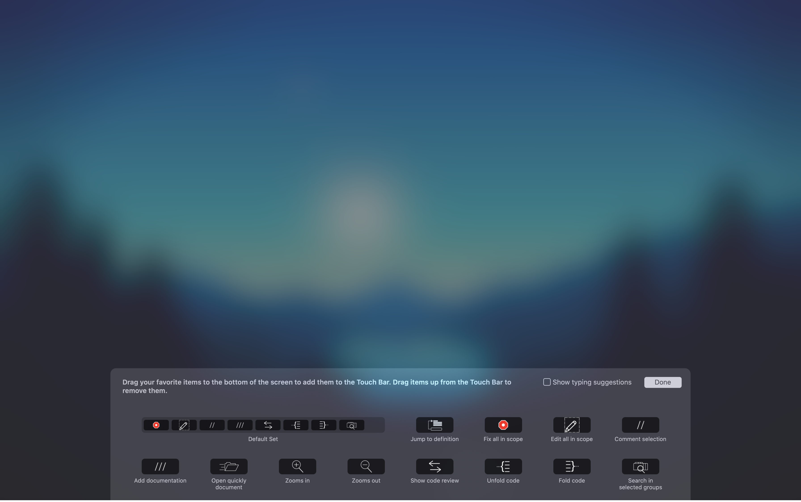

[](https://www.gnu.org/licenses/gpl-3.0)

# XTouchBar

XTouchBar replaces the MacBook Touch Bar with shortcuts and Xcode commands. It runs
as a menu bar app, so it does not appear in the Dock or in the app switcher.




## Use and customize

- Click **🆇** in the macOS menu bar, then **Preferences** to open Apple's Touch Bar
  customization palette. Drag commands into or out of the bar.
- Choose **All Xcode Commands…** to search the bundled catalog of 512 Xcode commands.
  Select a command and choose **Run in Xcode** to dispatch it.
- Choose **Bridge Status…** to check whether XTouchBar is connected to Xcode.
- To add or change a Touch Bar item in code, edit `Shortcut+Instances.swift`, then
  register its identifier and `Shortcut` in `TouchBar+Identifiers.swift` and
  `TouchBarPresenter.swift`.

## Xcode command route

XTouchBar uses command identifiers and selectors discovered from Xcode's IDEKit
command catalog. It sends the selected identifier to a small host library loaded inside
XcodeResearch over a local `CFMessagePort`. The host finds a compatible handler in the
active editor or workspace responder chain, checks its Objective-C method signature,
and dispatches it on Xcode's main thread.

This is the active IDEKit route. The older experiment using
`IDECommandManager.cacheCommandDefinitionsAndHandlers()` and
`sendActionForCommandWithIdentifier:from:` is **not** used by the bridge; that private,
stateful API required additional command-cache setup. The current route uses the
catalog's IDEKit identifiers to resolve existing handlers directly.

The snapshot contains 512 identifiers from Xcode 26.5. A command can still be missing
or disabled in a different Xcode version or editor context. A successful dispatch
means Xcode accepted the action, not that the operation finished.

## Build and connect

Open `XTouchBar.xcworkspace` in Xcode and build the `XTouchBar` scheme. To build and
load the bridge into the prepared `/Applications/XcodeResearch.app`, run this from the
repository root:

```sh
bash XcodeCommandBridge/Host/load-into-research.sh
```

Keep XcodeResearch open while using direct commands. The bridge is loaded into that
process and must be loaded again after XcodeResearch restarts. The helper opens this
workspace, attaches LLDB, loads the library, and verifies the connection.

The default **Command Backend → Direct Xcode Commands** uses the bridge. **Keyboard
Shortcuts (Legacy)** sends keyboard shortcuts instead and may require Accessibility
permission and a US keyboard layout. Direct command failures never retry as keystrokes.

For the CLI, architecture details, runtime discovery, and validation steps, see
[XcodeCommandBridge/README.md](XcodeCommandBridge/README.md).

## Credits

Inspired by [MTMR](https://github.com/Toxblh/MTMR). Touch Bar icons were contributed by
[Megg](https://www.instagram.com/meggi_lindova/). Original project video:
[XTouchBar in action](https://vimeo.com/425121496).
